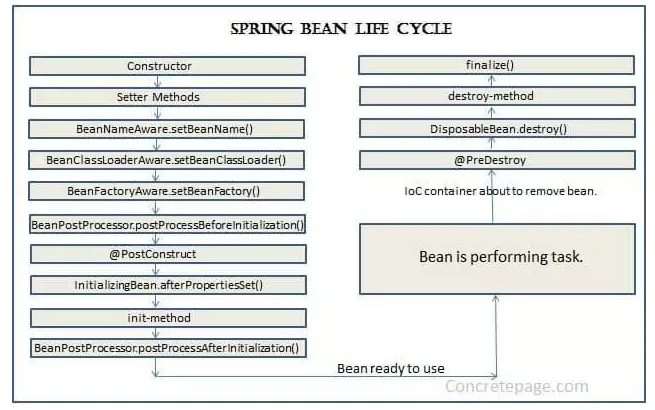

# Buổi 6: SPRING MVC
---
- [Buổi 6: SPRING MVC](#buổi-6-spring-mvc)
  - [1. Bean trong SpringBoot](#1-bean-trong-springboot)
    - [1.1 Bean là gì?](#11-bean-là-gì)
      - [1.1.1 Định nghĩa](#111-định-nghĩa)
      - [1.1.2 Các loại bean](#112-các-loại-bean)
      - [1.1.3 Cách tạo bean](#113-cách-tạo-bean)
        - [1.1.3.1: Sử dụng các Annotation đánh dấu lên Class](#1131-sử-dụng-các-annotation-đánh-dấu-lên-class)
        - [1.1.3.2 Sử dụng @Bean đánh dấu lên Method](#1132-sử-dụng-bean-đánh-dấu-lên-method)
      - [1.1.4 Các loại injection](#114-các-loại-injection)
        - [1.1.4.1 Field-based Injection](#1141-field-based-injection)
        - [1.1.4.2 Constructor-based Injection](#1142-constructor-based-injection)
        - [1.1.4.3 Setter-based Injection](#1143-setter-based-injection)
    - [1.2 BeanFactory và ApplicationContext?](#12-beanfactory-và-applicationcontext)
    - [1.3 Vòng đời Bean](#13-vòng-đời-bean)
      - [1.3.1. Định nghĩa:](#131-định-nghĩa)
      - [1.3.2 @PostConstructor và @PreDestroy](#132-postconstructor-và-predestroy)
  - [2. String MVC : @Controller, Thymeleaf](#2-string-mvc--controller-thymeleaf)
    - [2.1 @Controller](#21-controller)
    - [2.2 Thymleaf](#22-thymleaf)
  - [3. @SpringBootApplication](#3-springbootapplication)
  - [4. Thư viện Lombok](#4-thư-viện-lombok)
    - [4.1 ``@Getter``, ``@Setter`` và ``@ToString``](#41-getter-setter-và-tostring)
    - [3.2 ``@Data``](#32-data)
    - [3.3 ``@Builder``](#33-builder)
    - [3.4 Các loại ``@Constructor``](#34-các-loại-constructor)
  - [5. Log trong SpringBoot](#5-log-trong-springboot)
    - [5.1 Annotation ``@Slf4j``](#51-annotation-slf4j)
    - [5.2 Cách sử dụng ``@Slf4j``](#52-cách-sử-dụng-slf4j)

---
## 1. Bean trong SpringBoot
### 1.1 Bean là gì?
#### 1.1.1 Định nghĩa
Trong thế giới Java thuần, chúng ta phải tự tạo ra các object bằng từ khóa new và tự quản lý vòng đời của chúng. Trong Spring, Bean đơn giản là một object trong Java, nhưng nó được khởi tạo, lắp ráp (bơm các dependency) và quản lý hoàn toàn bởi Spring IoC Container (Inversion of Control). Thay vì phải tự đi tìm các object khác để dùng, Spring sẽ đứng ra làm "nhà máy" quản lý và tự động "bơm" (inject) những thứ cần vào class của.
#### 1.1.2 Các loại bean
- Singleton (mặc định): IoC container chỉ tạo đúng duy nhất 1 object từ class bean này
- Prototype: return một bean object riêng biệt cho mỗi lần sử dụng.
#### 1.1.3 Cách tạo bean
##### 1.1.3.1: Sử dụng các Annotation đánh dấu lên Class
Đây là cách phổ biến nhất khi tự viết code (các class nghiệp vụ của ứng dụng). Chúng ta sẽ đặt một annotation lên ngay trên khai báo class.
- ``@Component``: Là annotation gốc, chung nhất để đánh dấu một class là một Spring Bean.

Các Stereotype Annotations: Dựa trên @Component, Spring cung cấp các bản thể cụ thể hơn để phân chia vai trò rõ ràng trong kiến trúc ứng dụng:

- ``@Controller / @RestController``: Dành cho tầng giao tiếp (nhận HTTP requests).
- ``@Service``: Dành cho tầng chứa logic nghiệp vụ (Business Logic).
- ``@Repository``: Dành cho tầng giao tiếp với cơ sở dữ liệu (Database).
  ``@Configuration``: không tham gia vào luồng xử lý dữ liệu (không chứa business logic). Vai trò của nó giống như một "bản thiết kế nhà máy". Nó đứng đằng sau hậu trường để thiết lập hệ thống, định nghĩa cấu hình, và quan trọng nhất là làm "nơi chứa" cho các phương thức ``@Bean``

Cơ chế hoạt động: Khi ứng dụng Spring Boot chạy, tính năng @ComponentScan sẽ quét qua toàn bộ các thư mục mã nguồn. Hễ thấy class nào có gắn các annotation trên, nó sẽ tự động dùng constructor (thường là mặc định) để khởi tạo object đó và đưa vào IoC Container.
Ví dụ:
```java
@Service
public class UserService {
}
```
##### 1.1.3.2 Sử dụng @Bean đánh dấu lên Method
Cách này được sử dụng khi chúng ta không thể hoặc không nên đánh dấu Annotation lên class. Thường gặp nhất là khi chúng ta muốn tạo Bean từ các class thuộc thư viện của bên thứ 3 (ví dụ: PasswordEncoder của Spring Security, ObjectMapper của Jackson), hoặc khi ta cần viết code logic phức tạp để khởi tạo một object trước khi đưa nó cho Spring quản lý.
Cách dùng:
- Phải đặt phương thức này bên trong một class được đánh dấu là ``@Configuration``.
- Phương thức sẽ return về object  muốn tạo, và được gắn ``@Bean``.
- 
Ví dụ:
```java
@Configuration
public class SecurityConfig {
    @Bean
    public PasswordEncoder passwordEncoder() {
        return new BCryptPasswordEncoder(10); 
    }
}
```
#### 1.1.4 Các loại injection
##### 1.1.4.1 Field-based Injection
Đây là cách bơm phụ thuộc trực tiếp vào thuộc tính (field) của class thông qua annotation ``@Autowired``

Ví dụ:
```java
@Controller
public class UserController {
    @Autowired
    private UserService userService;
}
```
**Ưu điểm:** Code rất ngắn gọn, dễ đọc.

**Nhược điểm:** Không được khuyến khích (Bad Practice). Nó phá vỡ tính đóng gói của OOP, không thể khai báo biến là final,...
##### 1.1.4.2 Constructor-based Injection
Đây là cách truyền phụ thuộc thông qua hàm khởi tạo (Constructor), sử dụng ``@Autowired`` hoặc không cũng đươc

Ví dụ:
```java
@Controller
public class UserController {
    private final UserService userService;

    public UserController(UserService userService) {
        this.userService = userService;
    }
}
```
Đây là BEST PRACTICE (Cách chuẩn mực nhất).

**Ưu điểm:**
- Cho phép sử dụng từ khóa final để biến trở thành bất biến (Thread-safe).
- Đảm bảo Bean không bao giờ bị Null khi sử dụng (bắt buộc phải có dependency thì class mới khởi tạo được).
- Rất dễ viết Unit Test.
##### 1.1.4.3 Setter-based Injection
Thay vì truyền qua Constructor, ta truyền Bean qua các hàm Setter. sử dụng @Autowired
Ví dụ:
```java
@Controller
public class UserController {
    private UserService userService;

    @Autowired
    public void setUserService(UserService userService) {
        this.userService = userService;
    }
}
```
Cách này ít sử dụng
### 1.2 BeanFactory và ApplicationContext?
BeanFactory và ApplicationContext interface là 2 interface đại diện cho Spring IoC container.

BeanFactory là root interface dùng để thao tác với Spring Container, nó cung cấp những tính năng cơ bản để quản lý bean trong ứng dụng. 

ApplicationContext interface là một sub-interface của BeanFactory, vì vậy nó cung cấp tất cả các tính năng trong BeanFactory ngoài ra nó còn cung cấp một số tính năng quan trọng khác.
### 1.3 Vòng đời Bean
#### 1.3.1. Định nghĩa:
Vòng đời (life cycle) của bean được hiểu là từ khi bean được tạo ra cho tới khi chết đi, sẽ có những sự kiện (event) khác nhau xảy ra. Về vòng đời của bean có thể mô tả bởi sơ đồ sau.

Gồm các giai đoạn chính sau:
- IoC container tạo bean bằng cách gọi constructor (có thể inject các bean dependency vào đây)
- Gọi các setter method để inject các bean vào bằng setter based injection
- Các method khởi tạo khác được gọi (không cần quan tâm nhiều)
- ``@PostConstructor`` được gọi
- Init method được gọi
- Gọi ``@PreDestroy``
- Hủy bean như các object thông thường
#### 1.3.2 @PostConstructor và @PreDestroy
- ``@PostConstruct`` là sau khi bean đã khởi tạo xong
- ``@PreDestroy`` là trước khi bean bị phá hủy
Chúng ta dùng hai annotation trên đánh dấu lên method nào đó, method đó sẽ được tự động gọi khi sự kiện bean xảy ra.
```java
class Car {
    @Autowired
    private final Engine engine;
    
    @PostConstruct
    public void testRun() {
        engine.run();
        engine.stop();
    }
    
    @PreDestroy
    public void stopEngine() {
        engine.stop();
    }
}
```
Dùng trong thực tế thì hai annotation trên làm các nhiệm vụ như:
- ``@PostConstruct`` dùng để thực hiện một số task khi khởi tạo bean
- ``@PreDestroy`` thực hiện các task để dọn dẹp bean sau khi dùng xong
---
## 2. String MVC : @Controller, Thymeleaf
### 2.1 @Controller
@Controller là một Stereotype Annotation chuyên biệt để đánh dấu một class làm nhiệm vụ tiếp nhận các HTTP Request từ người dùng, điều hướng logic và trả về giao diện.

Cơ chế hoạt động: Khi một method trong @Controller thực thi xong, nó thường trả về một chuỗi String. Trong Spring MVC, chuỗi này không phải là văn bản hiển thị cho người dùng, mà là tên của một file View (ví dụ: index, user-list).
### 2.2 Thymleaf
Thymeleaf là một Java template engine hoạt động ở phía server, được sinh ra để thay thế công nghệ JSP cũ kỹ. Nhiệm vụ của nó là nhận dữ liệu từ Model (do @Controller gửi sang) và nhúng động vào file HTML tĩnh.

---
## 3. @SpringBootApplication
``@SpringBootApplication`` luôn được đặt ở class chứa hàm main (điểm bắt đầu của chương trình). Nó không chỉ là một annotation đơn lẻ mà thực chất là một Meta-annotation (một annotation bao gộp nhiều annotation khác).

Nó bao gồm 3 annotation quyền lực nhất:
- ``@SpringBootConfiguration`` (Bản chất là ``@Configuration``): Đánh dấu class này là một lớp cấu hình.
- ``@EnableAutoConfiguration``: Nó báo cho Spring biết: "Hãy tự động cấu hình ứng dụng dựa trên các file .jar có trong classpath".

    Ví dụ: Nếu Spring Boot thấy có thư viện mysql-connector-j và spring-data-jpa trong file pom.xml, nó sẽ tự động cấu hình kết nối database, chúng ta không cần phải viết code khởi tạo DataSource hay EntityManagerFactory cồng kềnh như Spring đời cũ.

- ``@ComponentScan``: Ra lệnh cho Spring đi quanh thư mục hiện tại (chứa class main) và toàn bộ các thư mục con bên trong nó để tìm kiếm các class được đánh dấu là @Component, @Service, v.v., và đưa chúng vào IoC Container.
---
## 4. Thư viện Lombok
Lombok là một thư viện can thiệp vào quá trình biên dịch (compile-time) của Java. Nó giúp tự động sinh ra những đoạn code rườm rà, lặp đi lặp lại như getter, setter, constructor chỉ bằng các annotation, giúp class cực kỳ ngắn gọn và dễ bảo trì.
### 4.1 ``@Getter``, ``@Setter`` và ``@ToString``
``@Getter`` / ``@Setter``: Tự động sinh ra các hàm get (lấy giá trị) và set (gán giá trị) cho các thuộc tính.

``@ToString``: Tự động sinh hàm toString(), in ra chuỗi chứa tên class và giá trị các biến bên trong.

**Ví dụ:**
```java
import lombok.Getter;
import lombok.Setter;
import lombok.ToString;

@Getter
@Setter
@ToString
public class User {
    private Long id;
    private String username;
}
// Cách dùng:
// User user = new User();
// user.setUsername("anhnd");      <-- Hàm set tự động có
// System.out.println(user);       <-- Output: User(id=null, username=anhnd)
```
### 3.2 ``@Data``
Là annotation "tất cả trong một" (All-in-one). Nó tự động bao gồm: ``@Getter``, ``@Setter``, ``@ToString``, ``@EqualsAndHashCode`` và ``@RequiredArgsConstructor``.
### 3.3 ``@Builder``
Cung cấp cơ chế khởi tạo đối tượng (Object) theo dạng chuỗi nối tiếp . Giúp chúng ta tạo object có nhiều tham số một cách rõ ràng mà không cần nhớ vị trí từng tham số như dùng Constructor truyền thống.
```java
import lombok.Builder;
import lombok.ToString;

@Builder
@ToString
public class Product {
    private Long id;
    private String name;
    private double price;
    private int stock;
}

// Cách dùng:
// Product p = Product.builder()
//               .name("Laptop")
//               .price(1500.0)
//               .build(); 
```
### 3.4 Các loại ``@Constructor``
- ``@NoArgsConstructor``: Tự sinh constructor rỗng

- ``@AllArgsConstructor``: Tự sinh constructor chứa tất cả các thuộc tính.

- ``@RequiredArgsConstructor``: Tự sinh constructor chỉ chứa các thuộc tính được đánh dấu là final hoặc ``@NonNull``. Rất hay dùng trong Spring Boot để tiêm Dependency Injection.
Ví dụ:
```java
import lombok.NoArgsConstructor;
import lombok.AllArgsConstructor;
import lombok.RequiredArgsConstructor;
import org.springframework.stereotype.Service;

// 1. Ví dụ DTO cần đủ 2 constructor
@NoArgsConstructor
@AllArgsConstructor
public class Student {
    private String id;
    private String name;
}
// Có thể gọi: new Student() hoặc new Student("123", "Nguyen Van A")
```
```java
// 2. Ví dụ dùng cho Dependency Injection trong Spring Boot
@Service
@RequiredArgsConstructor
public class OrderService {
    
    // Khai báo final, Lombok sẽ tự nhét biến này vào Constructor
    private final PaymentRepository paymentRepo; 
    
    // Không cần viết @Autowired hay viết tay Constructor nữa!
}
```
---
## 5. Log trong SpringBoot
SLF4J (Simple Logging Facade for Java): Bản chất nó chỉ là một giao diện (Interface) tiêu chuẩn, không có chức năng ghi log thực tế. Nó cung cấp các hàm API chuẩn (log.info(), log.error()) để mã nguồn không bị phụ thuộc cứng vào bất kỳ một thư viện log cụ thể nào.

Log4j / Logback: Đây là các thư viện thực thi (Implementation) nằm bên dưới SLF4J. Chúng chịu trách nhiệm xử lý logic ghi log ra file, console hoặc đẩy lên server. Lưu ý: Mặc định Spring Boot sử dụng Logback, nhưng chúng ta hoàn toàn có thể loại bỏ nó và cấu hình để sử dụng Log4j2 nếu cần hiệu năng cao hơn.

### 5.1 Annotation ``@Slf4j``
Trong Java truyền thống, để tạo một bộ ghi log, ta phải khai báo một hằng số tĩnh khá rườm rà: ``private static final Logger log = LoggerFactory.getLogger(MyClass.class);``.

Annotation ``@Slf4j`` của Lombok sinh ra để giải quyết việc này. Khi chúng ta gắn nó lên đầu class, trong quá trình biên dịch (compile), Lombok sẽ tự động "tiêm" dòng code khai báo trên vào bytecode. Nhờ đó, ta chỉ cần gọi trực tiếp biến log để sử dụng, giúp class sạch và tập trung vào nghiệp vụ chính.
### 5.2 Cách sử dụng ``@Slf4j``
Ví dụ:
```java
import lombok.extern.slf4j.Slf4j;
import org.springframework.stereotype.Service;

@Service
@Slf4j // 1. Khai báo annotation ở đầu class
public class OrderService {

    public void processOrder(String orderId, int amount) {
        // 2. Dùng log.info cho các mốc nghiệp vụ bình thường
        log.info("Bắt đầu xử lý đơn hàng ID: {}", orderId);

        // 3. Dùng log.debug để in các biến phục vụ debug (sẽ tắt trên Production)
        log.debug("Chi tiết đơn hàng - ID: {}, Số lượng: {}", orderId, amount);

        if (amount <= 0) {
            // 4. Dùng log.warn khi có dữ liệu bất thường nhưng chưa đến mức sập hệ thống
            log.warn("Đơn hàng {} có số lượng không hợp lệ (amount = {}). Hủy xử lý.", orderId, amount);
            return;
        }

        try {
            // Giả lập logic lưu vào database bị lỗi
            saveToDatabase(orderId);
            log.info("Xử lý đơn hàng {} thành công.", orderId);

        } catch (Exception e) {
            // 5. Dùng log.error khi bắt được Exception, PHẢI truyền kèm đối tượng 'e'
            log.error("Lỗi nghiêm trọng khi lưu đơn hàng {} vào cơ sở dữ liệu.", orderId, e);
        }
    }

    private void saveToDatabase(String orderId) throws Exception {
        throw new Exception("Lỗi mất kết nối Database!"); // Giả lập lỗi
    }
}
```

**Lưu ý khi viết log:**
- Tuyệt đối không dùng dấu + để nối chuỗi:
    **Sai:** log.info("User " + username + " đã đăng nhập"); (Việc này tốn tài nguyên bộ nhớ để tạo chuỗi mới).
    **Đúng:** log.info("User {} đã đăng nhập", username); (Sử dụng cú pháp cặp ngoặc nhọn {} gọi là placeholder, SLF4J sẽ tự động nội suy giá trị biến vào đó).
- Tham số Exception luôn đứng cuối cùng và không có placeholder: Khi ta muốn log một lỗi, đối tượng Exception (thường là biến e) phải là tham số cuối cùng truyền vào hàm log.error(), và không được đặt {} cho nó trong chuỗi thông báo. SLF4J sẽ tự động nhận diện và in ra toàn bộ StackTrace (dấu vết lỗi).
    **Đúng:** log.error("Xảy ra lỗi tại ID: {}", id, e);